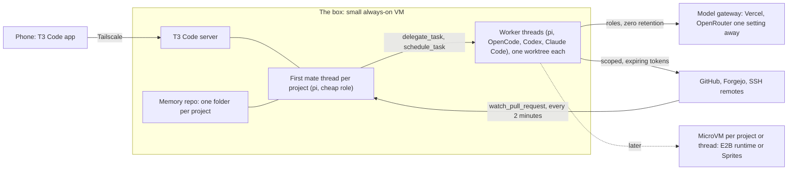

# Decision Record 2026-11-18: Open Cloud Agents from Mobile

## Status timeline

2026-11-18: Proposed by Claude, at JC's request

2026-11-21: Amended by Claude, while writing [SPEC-2026-11-21-first-mate](../../specs/SPEC-2026-11-21-first-mate.md): T3 Code's own orchestration tools, which its pi threads get too, already delegate threads, watch pull requests, and schedule tasks, so the first mate is a role prompt and memory files rather than new scripts.
T3 Code's built-in Forgejo and Gitea support replaces the planned pull request adapter.
GitHub access starts with a fine-grained token per box; GitHub App tokens wait until per-thread scoping is needed.

## Objective Context

JC asked for open options to recreate cloud agents driven from a native phone app: sandboxed agents, the most cost-effective harness and models, agnostic to both, on GitHub or personal git repositories, without lock-in.
JC then added: match or exceed Claude Code Projects, with a "first mate" per project.
Facts below were checked on 2026-11-18 unless a source gives another date; see [Sources](#sources).

### Simple, lovable, complete must haves

#### Functional

Start, steer, and review agent threads from a native iOS or Android app, with work continuing while the phone and laptop are off.
A first mate per project: one coordinating conversation that turns requests into threads, keeps project memory, says what needs JC, and follows pull requests, as Claude Code Projects does.
Works on GitHub repositories and on personal git hosts (Forgejo, Codeberg, or a plain SSH remote).
Any harness and any model per thread, chosen by cost per passed task.

#### Non-functional

No layer that only one vendor can run; each layer swaps with a config change or a re-run of a setup script.
Agents never run on JC's own computers by default, and each thread's git credentials are scoped to its repositories and expire.
Private by default: the zero data retention rules in [Model Gateway](2026-11-12-model-gateway.md) still apply.
Fixed cost under $10 a month before model spend.

### Nice to haves

#### Functional

Exceed Claude Code Projects where it is closed: models from any vendor, cost per thread visible, persistent workspaces that don't lose uncommitted work, any git host, and evals that gate harness and model changes.
Push notifications and voice.

#### Non-functional

Self-hostable end to end, so a vendor closing its source or raising prices costs a re-run of setup, not a rewrite.

### Avoid out of scope runaway rabbit hole risks

#### Functional

Building our own phone app, agent harness, or sandbox runtime.
Multi-user features before the single-user loop works.

#### Non-functional

Kubernetes or a fleet of machines for one person's projects.
Plugin and skill marketplaces as a source of code that runs with agent credentials.

## Decision

Six layers, each replaceable on its own, assembled from open source parts.
Only the first mate is new, and it is a role prompt plus memory files, set out in the spec ([spec first](#next-step)).

| Layer | Pick now | Warm alternative | Swap cost |
|-------|----------|------------------|-----------|
| Phone app and threads | [T3 Code](https://github.com/pingdotgg/t3code) (MIT) over Tailscale | [Happier](https://github.com/happier-dev/happier) (MIT), [Paseo](https://github.com/getpaseo/paseo) (Apache-2.0) | Install another client on the same box; harness sessions stay on disk |
| First mate | A coordinator thread per project on the `cheap` role, using T3 Code's orchestration tools to delegate threads, watch pull requests, and schedule tasks | [Omnara](https://github.com/omnara-ai/omnara) self-hosted (Apache-2.0) | Point the coordinator at another client's MCP (`happier mcp serve`) |
| Harness | [pi](https://github.com/earendil-works/pi), as in [Vendor-Neutral AI Harness](2026-09-26-vendor-neutral-ai-harness.md) | OpenCode, Codex CLI, Claude Code, any [ACP](https://agentclientprotocol.com) agent, picked per thread | Pick another provider in the thread |
| Sandbox | One always-on small VM as "the box" | MicroVM per project or thread: [E2B runtime](https://github.com/e2b-dev/runtime) self-hosted (Apache-2.0) or [Sprites](https://fly.io/sprites) hosted | Re-run the bootstrap script on another host |
| Models | Unchanged: [Model Gateway](2026-11-12-model-gateway.md) roles on Vercel AI Gateway | OpenRouter, one setting away | Already one setting |
| Git | Fine-grained GitHub token limited to chosen repositories, with an expiry; Forgejo repository-scoped tokens; SSH deploy keys | GitHub App installation tokens (one hour, per thread) | Credential helper per host |

### 1. Phone app and threads: T3 Code

- Native iOS and Android apps, plus desktop and web, all showing the same projects and threads from one server.
- Runs Claude Code, Codex, Cursor, OpenCode, and pi natively (`packages/provider-pi`), plus any ACP agent.
- Each thread can get its own git worktree; diffs, commits, pushes, and pull requests from the app.
- Runs headless on a VPS (`t3 up`, `t3 serve --tailscale-serve`), with one-time pairing per device and per-scope access.
- Agents inside a T3 thread, pi included (through a T3-owned pi extension), get T3's orchestration tools: `delegate_task` (a child thread on any provider and model, in its own worktree or on a linked machine), `create_threads`, `t3_thread_send` and `t3_thread_wait`, `watch_pull_request`, and `schedule_task` (on an interval, at a fixed time, or on a webhook).
  This is what makes a first mate possible without building a client or a service.
- Outside agents reach the same tools through its MCP server, at an access level JC approves, and scripts on the host use `t3 thread start`, `send`, and `show` without signing in.
- MIT, about 64,000 stars, active daily.
- Connect over Tailscale (free Personal plan, non-commercial, up to 6 users), not T3 Connect, whose relay's encryption and self-hosting aren't documented.
  Tailscale's control server is closed; [Headscale](https://github.com/juanfont/headscale) (BSD-3-Clause) is the self-hosted swap.

### 2. First mate: a coordinator thread per project

Each project gets one long-lived thread, on the `cheap` role at low effort, that JC talks to from the phone.
It reads the project's instructions and memory, turns requests into worker threads with T3 Code's orchestration tools, waits on them, and reports back.
Workers run on the `default` role, or `frontier` when asked.
T3 Code already provides the rest, so the new parts are a role prompt and a memory convention:

- Memory and instructions are Markdown files in a private git repository, one folder per project, with a `MEMORY.md` index, so memory is versioned, reviewable, and readable by any harness.
  A child thread gets only its task prompt, so the first mate passes the memory a task needs.
- Schedules are T3 scheduled tasks, made by the first mate with `schedule_task`.
- Pull requests: the first mate calls `watch_pull_request`, and T3 checks every two minutes and wakes it on a failed check, a review or comment, passing checks, or a conflict; child threads can't watch, so the delegating thread does.
- Thread states come from T3's sidebar sections (working, inbox, settled, snoozed), with push notifications and Live Activities on mobile.
- Decisions JC must make arrive as questions in the thread; pi's `select` and `confirm` dialogs show in T3's composer, and ACP stabilized structured form elicitation on 2026-07-22.

### 3. Harness: pi by default, any harness per thread

Same-model comparisons agree that the harness moves cost far more than pass rate, and pi was the cheapest per pass in both runs that included it:

| Source | Model | pi | OpenCode | Codex | Claude Code |
|--------|-------|----|----------|-------|-------------|
| [RUNTA FrontierHarness](https://runta.com/blog/introducing-frontierharness-eval/) (2026-09-01; vendor-run, 30 tasks, one attempt each) | Kimi K3 | 60.0%, $2.43 per pass | 50.0%, $3.24 | 66.7%, $3.47 | 63.3%, $18.34 |
| [Tensorlake](https://www.tensorlake.ai/blog/best-ai-coding-agents-2026) (2026-08-13; blog, 30 tasks; pi arm mostly on DeepSeek's own API) | DeepSeek V4 Flash | 66.7%, $0.028 per success | 46.7%, $0.073 | 53.3%, $0.081 | 53.3%, $0.195 |

[What Does a Harness Buy? Tokens, Mostly](https://arxiv.org/abs/2610.04433) (arXiv, 2026-10-03) finds up to 3x cost spread across Claude Code, mini-SWE-agent, and OpenCode on SWE-bench Verified with pass rates within 5 points, and that swapping harness flips about as many hard tasks as rerunning the same one.
The evidence is thin (one vendor-run benchmark, one blog), so this repo's evals stay the judge; `evals/run` already takes the harness as a setting.
Threads that pick Claude Code or Codex run those vendors' own CLIs, so they can sign in with JC's Claude or ChatGPT plan, with only that vendor's models (and, for Claude Code, the highest cost per pass above).

### 4. Sandbox: the box first, microVMs when a spec needs them

Model spend dominates cost per passed task, so sandboxes are chosen for persistence, openness, and idle behaviour, not rate.
A 20-minute thread on 2 vCPU and 4 GiB, with the CPU about 10% busy while waiting on the model (Sprites billed on 2 GB actually used), costs at list rates:

| Option | Open source | Isolation | Rates | Idle | 20-minute thread |
|--------|-------------|-----------|-------|------|------------------|
| Always-on VM: Hetzner CX23 (Germany or Finland) or Fly Machine shared-cpu-1x 1 GB (US) | Any Linux host | VM | €5.49 a month (new orders since 2026-06-15); $6.70 a month | Always billed | Fixed |
| [Fly Sprites](https://fly.io/sprites) | No (SDKs MIT) | Hardware-isolated VM | $0.0385 per CPU-hour used, $0.021875 per GB-hour used | Sleeps when idle; an open TCP connection keeps it awake | About $0.017 |
| [Cloudflare Containers](https://developers.cloudflare.com/containers/pricing/) | No | Container | $0.072 per vCPU-hour active, $0.009 per GiB-hour; Workers Paid $5 a month | Sleeps after a timeout | About $0.030 (2 vCPU, 8 GiB shape) |
| [Vercel Sandbox](https://vercel.com/docs/vercel-sandbox/pricing) | No | Firecracker | $0.128 per active CPU-hour, $0.0212 per GB-hour; Hobby includes 5 CPU-hours, 45-minute sessions | Memory bills while running | About $0.037 |
| [E2B](https://e2b.dev/pricing) | Runtime Apache-2.0; self-hosts on one KVM host ("Embed") | Firecracker | $0.0504 per vCPU-hour, $0.0162 per GiB-hour; Hobby sessions 1 hour, Pro $150 a month | Auto-pauses, resumes on traffic | About $0.055 |
| [Modal](https://modal.com/pricing) | No | Not stated on pricing page | $0.1419 per core-hour (2 vCPU), $0.024 per GiB-hour; $30 a month free credit | Bills max(request, usage) | About $0.079 |
| Daytona | No: went closed source in June 2026, repository archived | | Same rates as E2B | | About $0.055 |

For comparison, a passed task on real repositories cost $1.13 to $1.76 on DeepSeek V4.1 Flash and $5.14 to $25.80 on Opus 5.5 in FrontierCode 2.0 (checked 2026-11-12), so a sandbox is a few percent of a task.

Start with the box: one small always-on VM that holds T3 Code, the harnesses, the first mates, and the worktrees, built from one bootstrap script (`make` plus T3 Code and Tailscale), with agents as an unprivileged user and nothing of JC's own on it.
It is the cheapest fixed cost, keeps first mates reachable for schedules and webhooks, and moves to any Linux host.
Move a project or a thread into a microVM when the spec calls for stronger isolation or parallel heavy builds:

- Self-hosted: the E2B runtime, the only option with the same stack hosted and self-hosted, needs Linux with KVM.
  Hetzner Cloud VMs lack nested virtualization; Hetzner dedicated servers and AWS C8i, M8i, and R8i (nested virtualization since 2026-02-16) have it.
  [microsandbox](https://github.com/superradcompany/microsandbox) (Apache-2.0, libkrun) and Earendil's [Gondolin](https://github.com/earendil-works/gondolin) (Apache-2.0, experimental, keeps real secrets on the host and gives the VM a placeholder) are lighter options, and Gondolin already has a pi extension.
  [kubernetes-sigs/agent-sandbox](https://github.com/kubernetes-sigs/agent-sandbox) (Apache-2.0, v1.0.2) fits only if Kubernetes arrives for another reason.
- Hosted: Sprites, for a persistent per-project VM that sleeps when idle and keeps credentials out through its connectors.

### 5. Models: unchanged

Roles, gateway, and zero data retention stay as decided in [Model Gateway](2026-11-12-model-gateway.md); T3 Code runs pi with the repository's `.pi/settings.json` when the thread's folder is this repository.

### 6. Git: short-lived, repository-scoped credentials on every host

- GitHub: a fine-grained token limited to the chosen repositories, with an expiry, given to T3 Code and `gh` on the box.
  When one box serves projects that should not reach each other's repositories, move to a GitHub App owned by JC, whose installation tokens last one hour and can be limited per thread; since 2026-10-02 they are about 520 characters, so treat them as opaque strings.
- Forgejo or Codeberg: repository-scoped access tokens (Forgejo 15.0 and later) limited to `read:repository`, `write:repository`, and issue scopes; they can't do repository administration.
- Plain SSH remotes: one deploy key per repository.
- Pull requests and reviews go through T3 Code's own integrations: GitHub with a token or `gh`, Forgejo and Gitea with `fj` or `tea`, and GitLab, Bitbucket, and Azure DevOps too.

### Compared with Claude Code Projects

From the [Projects docs](https://code.claude.com/docs/en/claude-projects) (public beta on Pro, Max, and Ultra):

| Capability | Claude Code Projects | This proposal |
|------------|----------------------|---------------|
| Phone app | Claude app (iOS, Android) | T3 Code app (iOS, Android), MIT |
| Coordinator and threads | Built in; coordinator posts status on its own | First mate thread using T3's `delegate_task`; a role prompt to write |
| Models | Anthropic only; Opus at high effort by default | Any model per role, picked by cost per passed task |
| Harness | Claude Code | pi by default; OpenCode, Codex, Claude Code, or any ACP agent per thread |
| Repositories | GitHub, plus uploaded files | Any git remote: GitHub, Forgejo, Codeberg, SSH |
| Workspace | Cloud sandbox paused between turns; if it can't resume, the thread restarts from a fresh clone and uncommitted changes can be lost | Persistent box; microVM snapshots later |
| Memory | Project memory files and instructions in project settings | Markdown in a private git repository: versioned and portable |
| Pull requests | Watches and auto-fixes CI and review comments | T3's `watch_pull_request` wakes the first mate every two minutes on changes |
| Schedules | Cloud scheduled tasks | T3 scheduled tasks: interval, fixed time, once, or webhook |
| Overview, decision cards, library | Built in | T3 sidebar sections, push, Live Activities, questions in thread; no library |
| Connectors (Gmail, Drive, and so on) | Built in | MCP servers per harness, set up by hand |
| Cost | Plan limits, used faster than single sessions; 500 new threads a day | About €6 a month plus models at cost; cost per thread visible |
| Sharing | One user | One user now; T3 Code and Happier support more later |

Where Claude Code Projects stays ahead: no setup or upkeep, a coordinator that is already tuned, project files in one library, and connectors.
So keep using it while the first mate is built, then compare both on the same week of real tasks by cost per merged pull request and minutes of JC's attention.

### High-level C4(context/container/component/code) diagram

### Choices and Tradeoffs/Risks

Phone clients considered (all run agents on a machine you connect, not in their own cloud):

| Client | License | Stars | Native apps | Harnesses | Connection | Orchestration |
|--------|---------|-------|-------------|-----------|------------|---------------|
| T3 Code | MIT | 64k | iOS, Android, desktop, web | Claude Code, Codex, Cursor, OpenCode, pi, any ACP | LAN, Tailscale, T3 Connect | Projects and threads; delegation, pull request watching, and scheduled tasks for its agents; MCP for outside agents |
| Happy | MIT | 25k | iOS (Swift), Android (Kotlin) | Claude, Codex, Grok; OpenCode or any ACP | End-to-end encrypted relay | Subagent delegation; multiplayer |
| Paseo | Apache-2.0 (site) | 24k | iOS, Android, desktop, web | Claude Code, Codex, Copilot, OpenCode, pi, more through ACP | Encrypted relay, LAN, Tailscale | Agents launch agents; voice |
| Happier | MIT | 2.2k | iOS, Android, desktop, web | 13 including pi, any ACP | Encrypted relay you can self-host | `happier mcp serve` creates sessions; push inbox; voice |
| OpenCode Mobile | MIT | 0.3k | Android | OpenCode | Tailscale | None |

T3 Code over Happier: its projects-and-threads model maps onto Claude Code Projects, its agents already delegate, watch pull requests, and schedule work, and its community is the largest.
Happier is the fallback if T3 Code stalls: it has the self-hostable encrypted relay T3 Code lacks.
Closed clients (Claude app, ChatGPT's Codex remote, Maude, Cosyra, Vicoa) were ruled out for lock-in.

First mate options considered:

- T3 Code's orchestration tools plus a pi coordinator (chosen): no new service, same app as the threads.
- Omnara self-hosted (Apache-2.0): a full managed agent platform (REST API, Postgres state, schedules, memory, subagents, 12 sandbox providers or your own machines, Slack and Discord, open source mobile app), but its own agent loop rather than pi or ACP harnesses, Postgres and Redis to run, and a product that pivoted in January 2026.
  Switch to it if the glue grows past a few hundred lines.
- [Hermes Agent](https://hermes-agent.nousresearch.com/docs) (MIT, 264k stars): personal agent with 20+ messaging gateways (Telegram, Discord, Slack, Signal, email), cron, memory, subagents, and terminal backends (local, Docker, SSH, Daytona, Modal, Vercel Sandbox).
  A good first mate if JC prefers a chat app to a coding app, but it passed 50% in RUNTA's coding run, so it should hand coding to pi threads.
- [pi-chat](https://github.com/earendil-works/pi-chat): Discord and Telegram to sandboxed pi, a Gondolin VM per channel, memory files; 16 commits, early.
- [open-inspect/background-agents](https://github.com/open-inspect/background-agents) (MIT): Cloudflare control plane, Modal, Daytona, or E2B sandboxes, OpenCode or Claude Agent SDK, web, Slack, GitHub, and Linear clients, multiplayer; no phone app or coordinator, and it caches git credentials on disk where snapshots keep them.
- OpenHands (MIT): issue to pull request in a Docker sandbox; no coordinator.
- Not chosen: OpenClaw (341 malicious skills among 2,857 audited on ClawHub, and CVE-2026-25253, a one-click remote code execution), and Vibe Kanban (its company shut down in 2026 and handed it to the community).

Risks:

- T3 Code is young and gates contributions; its docs say pi threads get the orchestration tools and load project extensions once the folder is trusted, but pi with this repository's gateway extension and a pi first mate are untested here, so they are the spec's first check.
- One box means one blast radius: a prompt-injected thread can read other projects' worktrees.
  Short-lived tokens limit what it can push; a Linux user or microVM per project is the next step.
- Providers close or reprice: Daytona went closed source in June 2026, and Hetzner raised CX and CAX prices about 30% to 38% and CPX and CCX up to 2.7x on 2026-06-15.
  Keeping the box reproducible from one script keeps a move cheap.
- Sprites' idle rules are documented inconsistently and a restart after waking is reported, so test before relying on them.
- E2B's self-hosted runtime is not documented as SDK-compatible with E2B's cloud; verify before counting on one SDK for both.
- Same-model harness results come from one vendor benchmark and one blog; our evals decide.

### Dependencies

[Vendor-Neutral AI Harness](2026-09-26-vendor-neutral-ai-harness.md), [Model Gateway](2026-11-12-model-gateway.md), [Reproducible Environment](2026-09-26-reproducible-environment.md), and the evals in [`evals/`](../../evals/README.md).

### Interfaces

- Thread control: T3 Code's orchestration tools inside threads (`delegate_task`, `create_threads`, `t3_thread_send`, `t3_thread_wait`, `watch_pull_request`, `schedule_task`), the same tools over MCP for outside agents, and `t3 thread` on the host; Happier's `happier mcp serve` as the fallback.
- Harness: any provider T3 Code runs natively, or any ACP agent.
- Models: `harness/models.json` roles.
- Git: `git` with a credential helper per host; pull requests through T3 Code's integrations (`gh`, `fj` or `tea`).
- Box: one bootstrap script, so any Linux host with network access can become the box.
- Memory: Markdown with a `MEMORY.md` index in a private git repository.

## Next step

[SPEC-2026-11-21-first-mate](../../specs/SPEC-2026-11-21-first-mate.md): the box bootstrap, the first mate's role prompt and memory convention, checks on GitHub and Forgejo, and the week-long comparison with Claude Code Projects.

## Key Results and retrospective feedback

## Sources

- Claude Code Projects: https://code.claude.com/docs/en/claude-projects
- T3 Code: https://github.com/pingdotgg/t3code, and its `docs/user/remote-access.md`, `docs/user/outside-agents.md`, `docs/user/providers-pi.md`, `docs/user/source-control.md`, `docs/user/project-settings.md`, and `docs/orchestration-v2/orchestrator-mcp-server.md` (read 2026-11-21)
- Happy: https://github.com/slopus/happy; Happier: https://github.com/happier-dev/happier; Paseo: https://paseo.sh/claude-code; OpenCode Mobile: https://github.com/dzianisv/opencode-mobile
- Phone client comparison (published by Maude, one of the apps, updated 2026-10-30): https://maude.pilotdev.fr/compare/coding-agent-phone-apps/
- Omnara: https://github.com/omnara-ai/omnara; Hermes Agent: https://hermes-agent.nousresearch.com/docs; pi-chat: https://github.com/earendil-works/pi-chat; open-inspect: https://github.com/open-inspect/background-agents
- pi: https://github.com/earendil-works/pi; Gondolin: https://github.com/earendil-works/gondolin; OpenCode server: https://opencode.ai/docs/server/
- ACP updates (registry, transports working group, elicitation): https://agentclientprotocol.com/updates.md
- Harness costs: https://runta.com/blog/introducing-frontierharness-eval/, https://www.tensorlake.ai/blog/best-ai-coding-agents-2026, https://arxiv.org/abs/2610.04433
- Sandbox prices: https://e2b.dev/pricing, https://vercel.com/docs/vercel-sandbox/pricing, https://developers.cloudflare.com/containers/pricing/, https://modal.com/pricing, https://fly.io/sprites, https://fly.io/learn/ai-sandbox-pricing/, https://fly.io/learn/always-on-agent-hosting-cost/
- Sprites idle behaviour: https://docs.fly.io/sprites/working-with-sprites/, https://community.fly.io/t/sprite-restarts-by-itself-1-to-3-minutes-after-waking-from-idle-reproducible-sbd-storage/28796
- E2B runtime: https://github.com/e2b-dev/runtime; Daytona closed source: https://github.com/daytonaio/daytona (archived), https://github.com/nightona-co/nightona
- Hetzner prices: https://northflank.com/blog/hetzner-cloud-server-price-increases; nested virtualization: https://wz-it.com/en/blog/hetzner-cloud-vs-dedicated-server/, https://aws.amazon.com/about-aws/whats-new/2026/02/amazon-ec2-nested-virtualization-on-virtual
- Tailscale pricing: https://tailscale.com/pricing; Headscale: https://github.com/juanfont/headscale
- GitHub App tokens: https://docs.github.com/en/apps/creating-github-apps/authenticating-with-a-github-app/generating-an-installation-access-token-for-a-github-app, https://github.blog/changelog/2026-10-02-stateless-github-app-installation-tokens-rolled-out/
- Forgejo token scopes: https://forgejo.org/docs/latest/user/token-scope/
- OpenClaw security: https://www.esecurityplanet.com/threats/hundreds-of-malicious-skills-found-in-openclaws-clawhub/; Vibe Kanban shutdown: https://vibekanban.com/blog/shutdown
