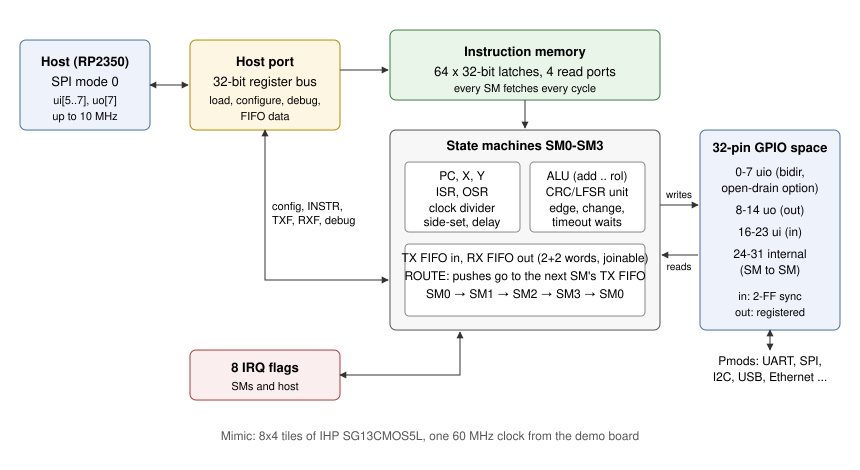

# Mimic architecture

Mimic is four small processors built for bit-banging, sharing an instruction memory, a pin
space, and a host port. Its starting point is the RP2040's PIO, whose idea holds up well:
single-cycle instructions with free side-set and delay make cycle-exact waveforms easy.
Mimic keeps that model and adds what PIO programs most often have to work around, aiming at the
competition's main question: can it run protocols nobody planned for?

| PIO limitation | Mimic |
|---|---|
| No arithmetic: counts and checksums need tricks or the CPU | `ALU`/`ALUI` on X and Y (add, sub, and, or, xor, shifts, rotate) and `X<Y` |
| No CRC: USB, Ethernet, CAN, SD, 1-Wire leave it to the CPU | A CRC/LFSR unit per SM, any polynomial up to 32 bits, fed by `IN`/`OUT` as bits pass |
| `WAIT` has no timeout and no edge detection | `wait rise`, `wait fall`, `wait change`, and a timeout that counts down in X |
| Constants come from the CPU through the FIFO | 16-bit immediates in `SET` and `ALUI` |
| One JMP pin per SM | `JMP` tests any pin, relative or absolute |
| Open drain by toggling directions | Per-pin open-drain mode; programs write 0 and 1 |
| SMs talk only through IRQs or real pins | Eight internal pins, and FIFO routing from one SM to the next |
| 32 instructions | 64 |

The result: UART, SPI and I2C take the same handful of instructions as on PIO, and protocols
PIO leaves to software (Ethernet's CRC-32, USB's NRZI, bit stuffing and CRCs, PS/2 parity,
pulse timing for infrared) run on the chip. See [protocols](protocols.md).

## State machine

Each SM fetches from its PC every cycle and, on a tick (every cycle, or every `INT+FRAC/256`
cycles with the clock divider), executes the instruction in that tick: decode, operand select,
one shared adder, one shared rotator, write-back. There is no pipeline, so there are no hazards
to explain: what an instruction writes, the next one sees.

- **One adder, one rotator.** `ADD`/`SUB`, `X--`, `Y--`, the timeout decrement and `X<Y` all use
  one 32-bit Kogge-Stone adder; `IN` and `OUT` shifts (both directions, any count) and the ALU's
  shifts all use one 32-bit rotator plus masks. An instruction only ever needs one of each.
- **Shifts by rotation.** Right-shift `IN` merges the new bits into the low end of ISR and
  rotates right; left-shift `IN` rotates left and merges; `OUT` rotates and masks. That makes
  every shift direction and count one rotator.
- **Pin writes** rotate the value and a mask by the base (5 mux levels each) for `OUT`/`MOV`/`SET`
  and again for side-set, then merge: side-set over the main write, higher SM over lower.
- **Stalls are combinational**: whether a `PUSH` or autopush can proceed depends on the
  destination FIFO and on whether the host or another SM writes it in the same cycle, computed
  each cycle with no loops (requests never depend on grants).
- **Forced instructions** (`INSTR` from the host, `OUT`/`MOV EXEC`) sit in a pending register
  the fetch prefers to the memory, and run without advancing the PC.

## Memory

64 words of 32 bits, written by the host and read by all four SMs every cycle. Storage is
2048 latches (31 µm² each) rather than flip-flops with enables (67 µm²), each word written
through its own clock gate built from a negative latch and an AND gate. Four 64:1 read
multiplexers cost more than the storage; that, not storage, is why the memory has 64 words.
See [the decision](decisions/2026-11-13-mimic-imem.md).

Programs share the memory freely: the loader relocates jumps and wrap points to wherever a
program goes. UART TX and RX together take 16 words, Ethernet TX and RX 60, and the two-SM
USB receiver all 64.

## FIFOs and routing

Each SM has a TX FIFO (host to SM) and an RX FIFO (SM to host) of two 32-bit words, which can
be joined into one four-word FIFO in either direction. With `ROUTE` an SM's pushes go to the TX
FIFO of the next SM in the ring instead of its own RX FIFO, so SMs form pipelines: the
low-speed USB receiver is a line-coding SM feeding a packet SM, and a UART receiver routed
into a UART transmitter makes a baud-rate converter with no host traffic. The host still writes
a routed FIFO; its write wins that cycle and the SM's push waits.

## Pins and the host port

The 24 pads and 8 internal pins form one 32-pin space every SM can read and write anywhere
(bases wrap at 32). Inputs are synchronized by two flip-flops; outputs are registered, so a
program's waveforms are glitch-free and line up with its ticks.

The host port is an SPI target, oversampled by the system clock, so the whole chip has one
clock domain. Three ui pins and one uo pin are the price: the other 20 pads are free for
protocols. [Host port](host.md) has the frames and registers.

## Area and timing

| Block | Synthesized area (µm²) |
|---|---|
| Instruction memory (latches, write gates, four read ports) | 158,000 |
| Four state machines | 4 x 80,000 |
| Four FIFO pairs | 4 x 14,500 |
| Host port, pins, IRQs, registers | 32,000 |
| **Total** | **520,000** of the 1.22 mm² 8x4 tile area (43% before buffering) |

These are Yosys's numbers for IHP SG13CMOS5L standard cells with the area-oriented mapping the
design uses (the default delay-oriented mapping added 38,000 buffers and even used I/O pad cells
as buffers, more than doubling the area; see [the decision](decisions/2026-11-13-mimic-area.md)).
The hardening results, including timing, are in the [verification write-up](verification.md#hardening).

The longest paths start at a PC, pass through the instruction memory's read multiplexer and the
decoder, and end at a register through the adder or the rotators. Two RTL changes shortened
them: pin writes get their own value multiplexer (sharing the write-back value put the adder on
the path to every pin), and the adder is a Kogge-Stone tree rather than a ripple chain.
